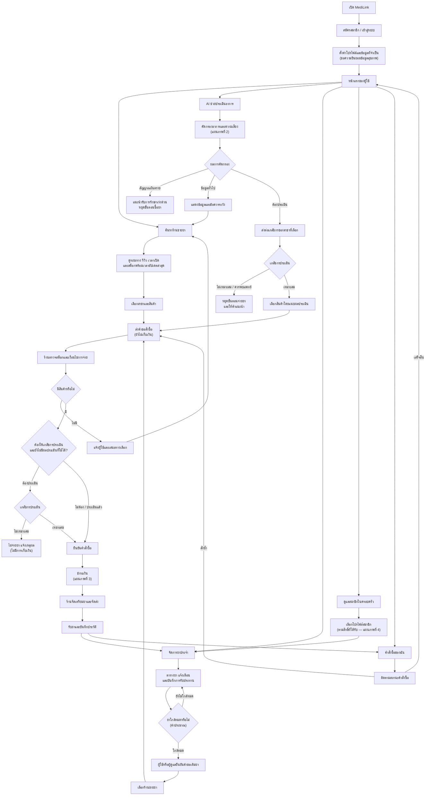
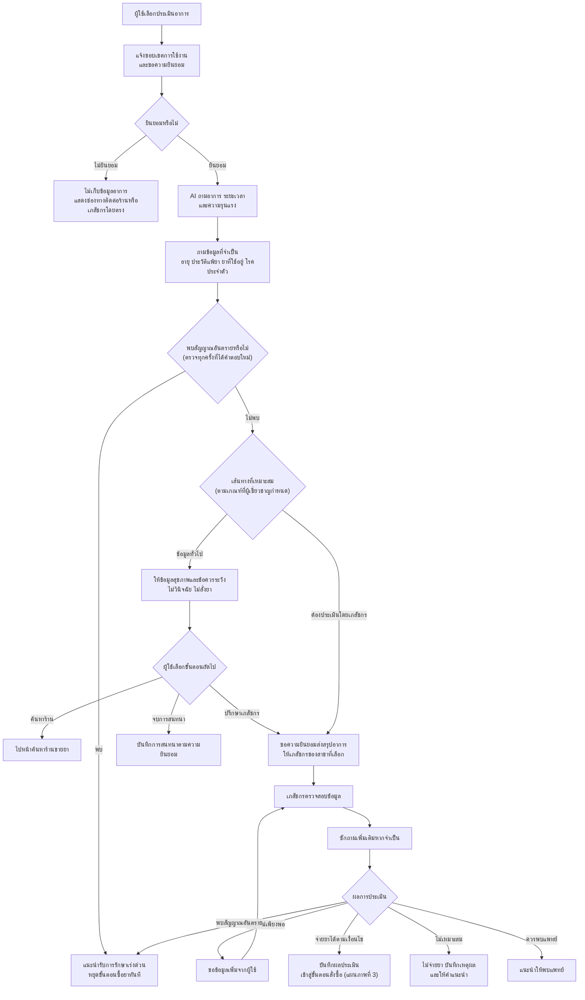
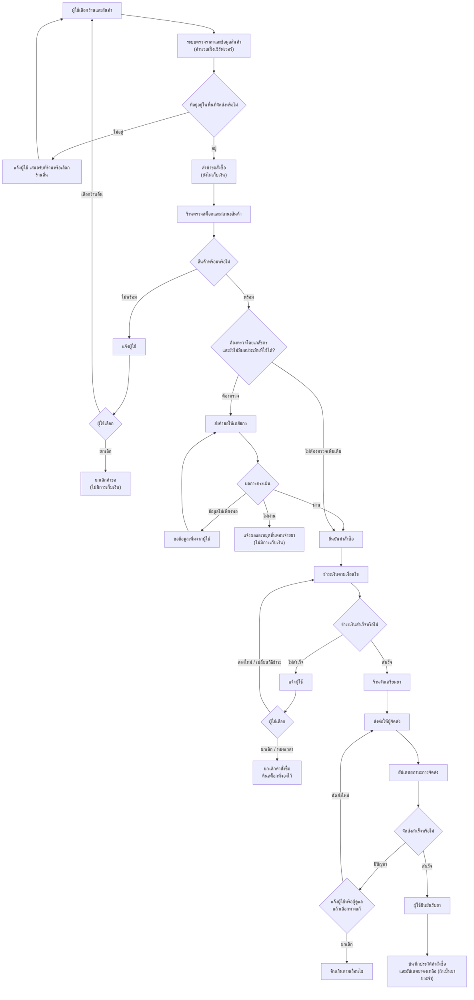
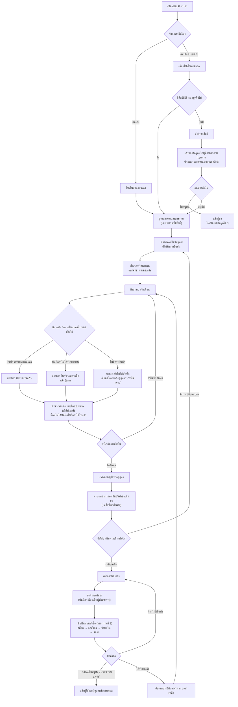
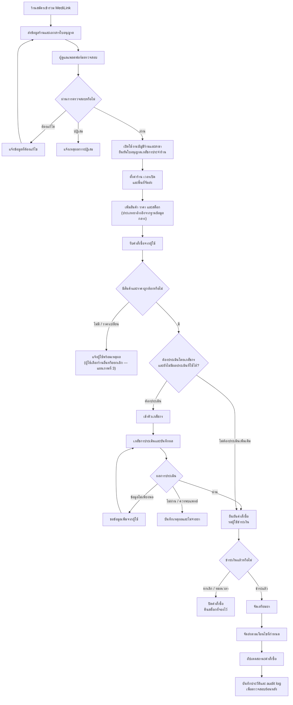

# MediLink — Flowcharts (ฉบับแก้ไข)

เอกสารนี้แทน flowchart ชุดเดิมทั้ง 5 ภาพ โดยแก้ช่องโหว่และจุดที่ไม่สอดคล้องกับเอกสาร Product Spec

## สรุปสิ่งที่แก้

| # | ปัญหาเดิม | แผนภาพ | การแก้ไข |
|---|---|---|---|
| 1 | เส้นทาง "ค้นหาและเลือกยา" ไปถึงยืนยันคำสั่งซื้อโดยไม่ผ่านจุดตัดสินว่าต้องให้เภสัชกรประเมินหรือไม่ | 1 | ทุกเส้นทาง (ค้นหาร้าน, AI, เติมยา) รวมเข้าที่ `ส่งคำขอสั่งซื้อ` จุดเดียว แล้วผ่านด่านเภสัชกรเดียวกัน |
| 2 | มีเส้นจาก "ชำระเงิน" ตรงไป "ร้านจัดเตรียมยา" โดยข้ามจุดเช็กปัญหาการชำระเงิน | 3 | ลบเส้นนั้นออก ทุกการชำระเงินต้องผ่าน `ชำระเงินสำเร็จหรือไม่` |
| 3 | ไม่มีผล "ข้อมูลไม่เพียงพอ" | 2, 3, 5 | เพิ่มผลนี้และวนกลับไปขอข้อมูลเพิ่ม |
| 4 | หลัง "ขออนุญาต" ไปดูข้อมูลยาได้เลยโดยไม่รอผลอนุมัติ | 4 | เพิ่มจุดตัดสิน `อนุมัติหรือไม่` กรณีไม่อนุมัติจะไม่เปิดเผยข้อมูล |
| 5 | การเติมยาไม่มีขั้นตอนชำระเงินและไม่มีทางแยกกรณีร้านไม่มีของ | 4 | ให้คำขอเติมยาเข้าสู่ขั้นตอนสั่งซื้อ (แผนภาพที่ 3) และเพิ่มทางแยกกรณีร้านไม่มีสินค้า |
| 6 | มีจุดที่จบโดยไม่มีทางไปต่อ | 1, 3, 5 | "แจ้งข้อมูลที่ต้องแก้ไข" วนกลับไปส่งเอกสารใหม่ / "เลือกร้านอื่น" วนกลับไปเลือกร้าน / "ติดตามคำสั่งซื้อ" มีทางไปต่อ |
| 7 | ภาพรวมให้เลือกสาขาก่อนถึงหน้าแรก ซึ่งไม่ตรงกับเอกสาร | 1 | ย้าย "ค้นหาร้าน" เป็นเมนูในหน้าแรกตามหัวข้อ 3 ของ Spec |
| 8 | ไม่แยก "ยังไม่ได้บันทึก" ออกจาก "ยืนยันว่าไม่ได้รับประทาน" | 4 | แยกเป็น 3 สถานะ: รับประทานแล้ว / ยืนยันว่าพลาดมื้อ / ยังไม่ได้บันทึก |
| 9 | ยังเก็บเงินก่อนรู้ผลได้ (ไม่ชัดเจน) | 3, 5 | ระบุว่าชำระเงินหลัง `ยืนยันคำสั่งซื้อ` เท่านั้น กรณียกเลิกหรือปฏิเสธก่อนหน้านั้นจึงไม่มีการเก็บเงิน |

> ข้อตกลงร่วมของทุกแผนภาพ: ด่านเภสัชกรมีเงื่อนไขว่า **"ต้องประเมิน และยังไม่มีผลประเมินที่ใช้ได้"** คำสั่งซื้อที่มาจากแชต AI ซึ่งเภสัชกรอนุมัติไปแล้ว จึงไม่ต้องให้ประเมินซ้ำ

---

## แผนภาพที่ 1: ภาพรวมแพลตฟอร์ม

---

## แผนภาพที่ 2: AI ช่วยประเมินอาการ

---

## แผนภาพที่ 3: สั่งซื้อ ชำระเงิน และจัดส่ง (ฝั่งผู้ใช้)

---

## แผนภาพที่ 4: จัดการยาประจำ ครอบครัว และเติมยา

---

## แผนภาพที่ 5: ร้านขายยาและเภสัชกร (ฝั่งร้าน)

